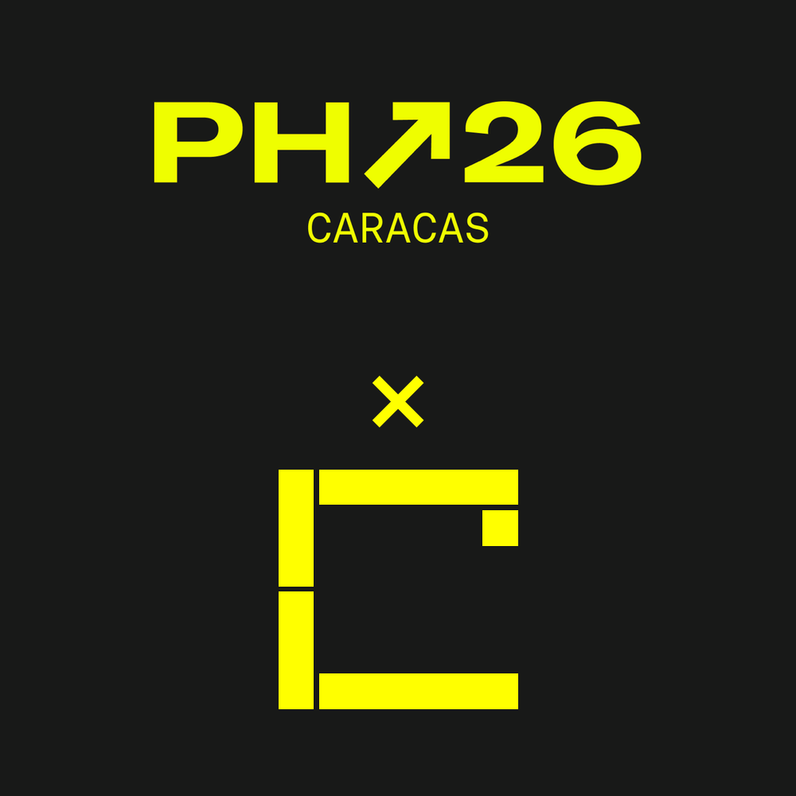

<div align="center">



# Constancia

**Your working life, provable. Only as much of it as you choose.**

<p align="center">
  <a href="https://platanus-hack-26-ve-team-24-rhg9.onrender.com">
    
  </a>
  <a href="https://github.com/platanus-hack/platanus-hack-26-ve-team-24/actions/workflows/cd.yml">
    
  </a>
  
</p>

<p align="center">
  
  
  
  
  
</p>

<p align="center">
  
  
  
  
  
</p>

<p align="center">
  
  
  
  
  
  
</p>

</div>

## 🧭 What it is

A work history is a PDF anyone edits in five minutes, and banks, landlords and consulates trust it
anyway. Constancia turns that history into a record that proves itself: every job is a certificate
signed by an employer the consortium has accredited, the holder keeps them, and the whole trajectory
seals into one **Verified CV** nobody can splice, pad or trim after the fact.

The holder shows one fact at a time, and the verifier sees exactly that fact, plus the count of what
stayed hidden.

The design targets two properties. **Trust without an intermediary:** the root is a consortium quorum,
checked by the verifier's own browser, not a company you have to phone. **Non-repudiation:** the
issuer signs with a device key, and the ledger anchors the hash next to that issuer and that key id,
so an employer cannot deny what it issued, and the holder cannot splice a job into a sealed CV.

## 🔄 How it works

1. **Employer** (`/employer`): HR signs in with a key on their device, applies to the consortium, and
   once a quorum approves, fills in one form. The result is a **PDF**: a readable visual layer plus
   the signed SD-JWT token and the holder's key inside the file. The hash is anchored on the ledger
   before the PDF is handed over. Requesting a certificate happens outside the platform.
2. **Verifier** (`/verify`): drop a PDF; five checks run in the browser and the data is read from the
   token, not from the visual layer. `/verify/lab` tries four forgeries, each failing at a named check.
3. **Holder** (`/present`): drop the credential PDF, choose which claims to show, and get a
   presentation PDF that does not contain the others at all (selective disclosure, not zero knowledge).
   `/join` unifies several credentials of the same person (same ID and name, each verified) into one
   sealed history PDF that `/verify` checks entry by entry. `/ledger` shows the consortium.

Demo: issue PDF -> `/verify` -> `/present` (pick claims) -> `/verify` -> issue a second PDF for the
same person -> `/join` -> `/verify`.

## 🏗️ Architecture

- **Credential:** W3C VC 2.0 secured with SD-JWT (selective disclosure), ES256 device keys.
- **Ledger:** a consortium contract with members and quorum, deployed on public Sepolia; stores the
  hash, the issuer and the signing key id, never personal data. Sepolia stands in for a permissioned
  consortium network we could not host on Render.
- **Accounts:** ERC-4337 accounts controlled by P-256 device keys
- **Server:** holds no credentials: only the ledger gateway, employer sessions and optional share links (ciphertext) on Postgres.
- **Verifier:** all five checks run in the browser, and files never leave the browser.

## 🧱 Stack

| Layer         | Technology                                                         |
| :------------ | :----------------------------------------------------------------- |
| Framework     | **Next.js 16.4** (App Router) with **React 19.3**                  |
| Language      | **TypeScript 5**, strict mode                                      |
| UI            | **Tailwind CSS 4**                                                 |
| Credentials   | **SD-JWT** (W3C VC 2.0), **ES256** via WebCrypto, **jose**         |
| Accounts      | **ERC-4337** smart accounts with **P-256** device keys             |
| Ledger        | **Sepolia**, **Solidity 0.8.28**, **Foundry** tests, **viem**      |
| Server data   | **PostgreSQL** with **Prisma 7** (ciphertext mailbox only)         |
| Validation    | **Zod 4**                                                          |
| Testing       | **Vitest 5**                                                       |
| Quality       | **oxlint** (type-aware) and **oxfmt**                              |
| Runtime       | **Node 24**, **pnpm 12**                                           |
| Delivery      | **GitHub Actions** verify, then deploy to **Render**               |

## 🚀 Run locally

```bash
pnpm install
cp .env.example .env.local   # fill the values
pnpm dev                     # http://localhost:3000
```

By default the app uses the in-memory ledger (`LEDGER_MODE=memory`, development and tests only). For
the real ledger set `LEDGER_RPC_URL` (Sepolia), `LEDGER_MODE=chain` and `NEXT_PUBLIC_LEDGER_MODE=chain`,
then run `pnpm chain:status` to check the connection.

Useful scripts: `pnpm db:migrate`, `pnpm db:studio`, `pnpm chain:identities`, `pnpm check:demo`.

## ✅ Before pushing

```bash
pnpm lint && pnpm typecheck && pnpm test && pnpm build
```

CI runs the same gates on every push to `main` before it triggers the Render deploy.

## 📁 Layout

| Path                   | Holds                                                  |
| :--------------------- | :----------------------------------------------------- |
| `src/app`              | App Router routes and API handlers                     |
| `src/lib`              | Credential, ledger, employer and mailbox logic         |
| `src/generated`        | Generated contract ABIs                                |
| `contracts`            | Solidity sources, Foundry tests and vendored P-256     |
| `prisma`               | Schema and migrations for the blind mailbox            |
| `scripts`              | Chain, seed, status and demo preflight scripts         |
| `docs/plan`            | Build plan, contracts, demo script and human guide     |

## ⚠️ Honest limits

- Selective disclosure, not zero-knowledge proofs.
- The ledger proves who said it and when, not that it is true: an accredited employer can lie, and
  revocation is the consequence.
- A shared link can be replayed until it expires.
- The browser reads the ledger through a single read-only gateway of ours, not its own node.
- The demo runs on public Sepolia, not on the consortium network it is designed for: we had no VPS to
  run the validators, and Render cannot host them. One sponsor wallet absorbs every fee, which is the
  property a permissioned network would give for free.
- All employers, members and people shown are fictional.

## 📚 Docs

[Product](PRODUCT.md) · [Design](DESIGN.md) · [Plan](docs/plan/README.md) ·
[Contracts](docs/plan/contracts.md) · [Demo script](docs/plan/demo.md) ·
[Human guide](docs/plan/human-guide.md)

## 👥 Team

team-24, Platanus Hack 26 Caracas.

- Diego Enrique Garcia Gonzalez ([@devgago](https://github.com/devgago))
- Luis Ochoa ([@tipotramquilo](https://github.com/tipotramquilo))
- Franklin Quintana ([@franku03](https://github.com/franku03))
- Gustavo Enrique Kufatty Anton ([@kufatty](https://github.com/kufatty))
- Jose Briceno ([@briluzaog](https://github.com/briluzaog))

## ☁️ Deploying to Render

Render can only connect to repositories you own, so mirror this repo to a personal one:

```bash
git remote set-url --add --push origin https://github.com/platanus-hack/platanus-hack-26-ve-team-24.git
git remote set-url --add --push origin https://github.com/<your-user>/<your-repo>.git
```

From then on `git push` updates both. Connect Render to the personal repo and import `render.yaml`
once (Dashboard → Blueprints → New Blueprint Instance).

`.github/workflows/cd.yml` runs on every push to `main`: lint, typecheck and build must pass, then it
triggers a Render deploy of that exact commit and waits until it is live. Repository secrets
(Settings → Secrets and variables → Actions):

| Secret                  | Required    | Where to get it                    |
| :---------------------- | :---------- | :--------------------------------- |
| `RENDER_DEPLOY_HOOK_URL` | yes        | Service → Settings → Deploy Hook   |
| `RENDER_API_KEY`        | to verify   | Account Settings → API Keys        |
| `RENDER_SERVICE_ID`     | to verify   | `srv-…` in the service URL         |

Optional repository variable `RENDER_SERVICE_URL` is printed once the deploy is live. Without the
hook secret the deploy job skips with a warning; without the other two it deploys but does not verify.