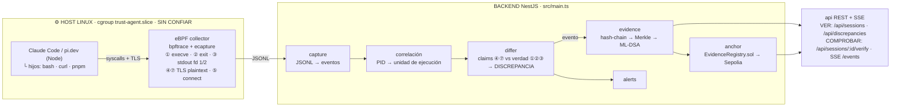

# BACKEND — la nueva arquitectura

> **Principio: el back no captura nada.** El kernel captura (eBPF); el back ingiere, correlaciona, detecta mentiras, sella, ancla y sirve. Cero middleware, cero userspace en la ruta de evidencia — si el harness miente, el kernel ya lo vio.
>
> El stage 0 (evidence/anchor/alerts/chaos) fue removido. Este doc es la spec de reconstrucción.

## Entornos prioritarios: Node

Los dos harness objetivo corren sobre Node:

| Harness | Runtime |
|---|---|
| **Claude Code** | Node (npm) — usa el node del sistema |
| **pi.dev** (`@earendil-works/pi-coding-agent`) | Node ≥ 22.19 — harness minimal |

Por qué Node: el Node de distro linkea `libssl.so` **dinámica** → ecapture (módulo openssl) hookea `SSL_write`/`SSL_read` en plaintext → el triángulo de evidencia queda completo (lo que el modelo dijo ⑦, lo que el harness registró ④, lo que realmente pasó ①②③).

Verificación en el host de demo (hacer hoy sábado, antes de dormir):

```sh
ldd $(which node) | grep libssl
# esperado: libssl.so.3 => /lib/x86_64-linux-gnu/libssl.so.3
```

Si el runtime trae OpenSSL estático (binario oficial nodejs.org / NodeSource), ④⑦ no son hookeables → **fallback**: caja negra de acciones (①②③⑤⑥⑧). El demo de exfiltración y anti-forense no depende de la TLS.

## Pipeline



Lectura: **ninguna flecha de userspace llega a ningún lado sin cruzar un probe del kernel.** La única TLS que el harness no ve es la de su propio hijo (⑤) — y el kernel la ve igual.

## Módulos — todo a construir, en este orden

### 1. `capture` — ingesta de la captura kernel
- Lee el JSONL que emite el collector del host (`bpftrace` + `ecapture`).
- Normaliza: `{ ts (monotónico), seq, pid, cgroup, session, tipo, payload }`.
- Se pierde cero eventos (seq propio por stream).

### 2. Correlación — unidades de ejecución
- Ensambla por PID: `execve(pid)` → `write fd 1/2 (pid)` → `exit_group(pid)` = una unidad de ejecución.
- Une argv en cadena (`bash → pnpm → node`) — match de cadena completa, no primer token.
- Asigna la unidad a la sesión del cgroup.

### 3. `differ` — el detector de mentiras
- **Claims**: bodies ④ (cada request al API trae el historial completo) y ⑦ (tool_use original).
- **Verdad**: unidades de ejecución.
- Tres diffs: **A** original-vs-ejecutado · **B** registrado-vs-resultados · **C** registrado-vs-original.
- Emite `DISCREPANCIA`. La truncación **declarada** no es discrepancia.
- Si todo matchea, también se sella: la cadena prueba las mentiras **y los días normales**.

### 4. `evidence` — sellado
- Hash-chain por sesión (`seq` + `prev_hash`), agregación Merkle, firma ML-DSA (`@noble/post-quantum`).
- Store en Postgres — el hash es la prueba.
- Endpoints a reconstruir: `POST /api/events`, `GET /api/sessions`, `GET /api/sessions/:id/events`, `GET /api/sessions/:id/state`, `GET /api/sessions/:id/verify`, `DELETE /api/sessions/:id`, SSE `/events`, `GET /health`.

### 5. `anchor` — anclaje
- Job periódico: raíz Merkle → `contracts/EvidenceRegistry.sol` (Sepolia). El contrato ya existe.

### 6. `alerts`
- Dispara cuando el differ emite `DISCREPANCIA`.

## Contrato de eventos del collector

| Probe | Línea | Campos |
|---|---|---|
| ① execve | `EXEC` | ts, pid, argv[] |
| ② exit_group | `EXIT` | ts, pid, code |
| ③ write fd 1/2 | `OUT` | ts, pid, fd, bytes (truncado ~4KB, marcado) |
| ⑤ connect | `NET` | ts, pid, ip:puerto |
| ④⑦ TLS | `TLS` | dirección (req/resp), body plaintext |

## Orden de construcción (deadline domingo 10:00, freeze 06:00)

1. **Host (hoy sábado):** `actions.bt` (bpftrace ①②③⑤), ecapture si `ldd` verde, probar bajo `systemd-run --slice=trust-agent.slice`.
2. `capture` + correlación — ingesta y unidades de ejecución.
3. `evidence` (rebuild) — hash-chain + Merkle + store + endpoints/SSE + health.
4. `differ` + scenario rogue: un agente real (Claude Code o pi.dev) mintiendo — el swarm viejo se reescribe sobre esto.
5. `anchor` — Sepolia con faucet probado.
6. `alerts`.

## Frontera

- Todo el host queda cubierto: syscalls del cgroup + TLS del proceso (④⑦) + TLS del hijo (⑤ — la que el harness no ve).
- **Techo epistémico:** la cadena de custodia empieza en el socket del harness. Del proveedor para arriba no hay testigo mayor — se declara así en el pitch.
- eBPF es per-host: cada host con agentes corre su collector.
